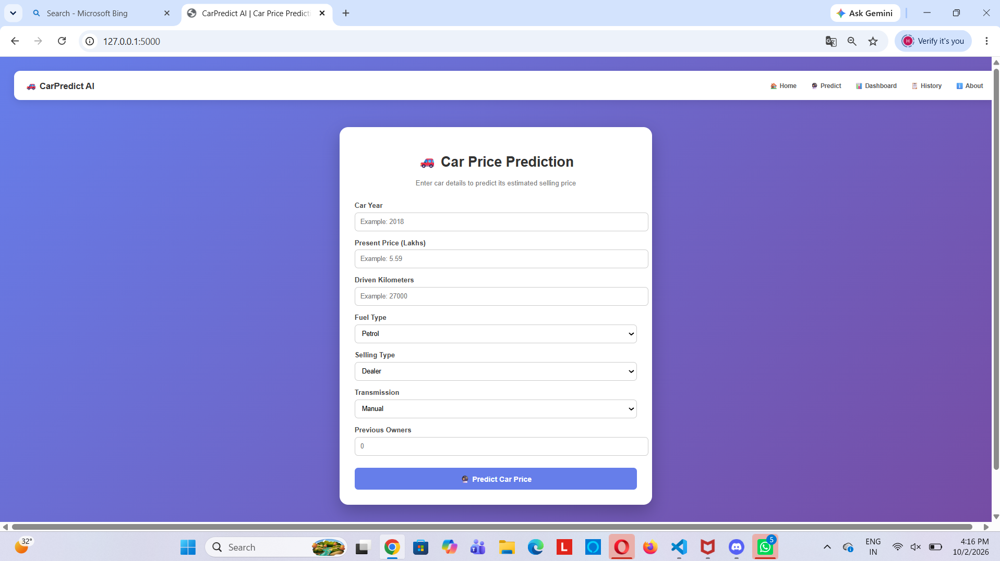
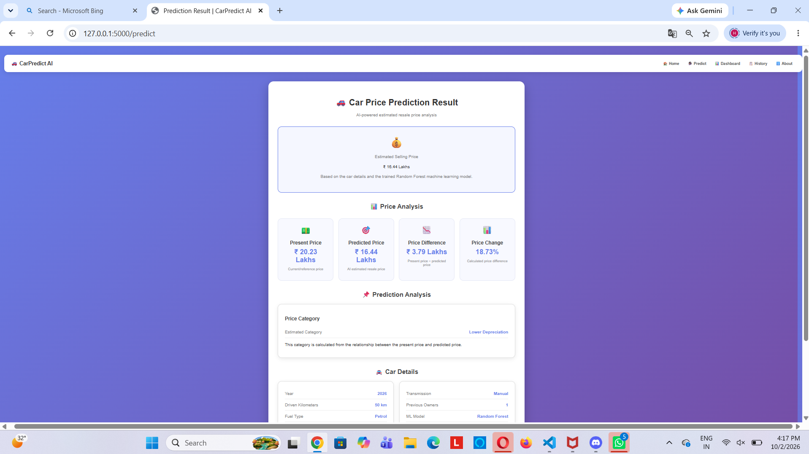
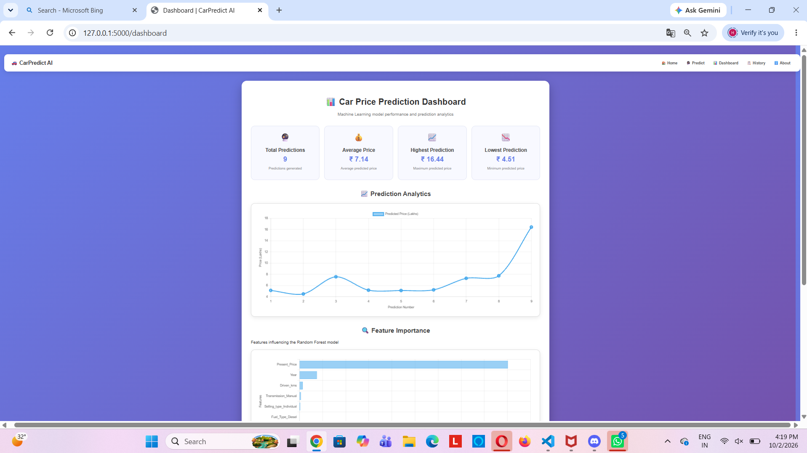
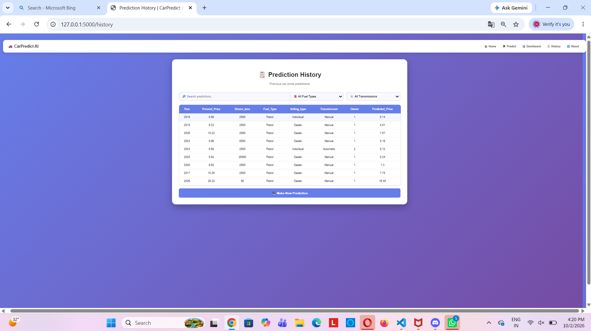

# 🚗 CarPredict AI

> An end-to-end machine learning web application for predicting used car selling prices.

## 📌 Project Overview

CarPredict AI is a machine learning-based web application that predicts the estimated selling price of a used car based on its features.

The project combines **Machine Learning, Data Analysis, and Flask Web Development** to create a complete end-to-end ML application.

Users can enter car details through a web interface and receive an estimated resale price generated by a trained **Random Forest Regression** model.

---

## 🎯 Project Objective

The main objectives of CarPredict AI are:

- Predict the estimated selling price of used cars.
- Analyze important factors affecting car prices.
- Evaluate different machine learning regression models.
- Provide an easy-to-use web interface.
- Store previous predictions for analysis.
- Present prediction insights through a professional dashboard.

---

## 🤖 Machine Learning

### Models Used

The project experiments with two regression models:

- Linear Regression
- Random Forest Regressor

The Flask application uses the trained **Random Forest Regressor** model for prediction.

### Features Used

The model uses:

- Year
- Present Price
- Driven Kilometers
- Fuel Type
- Selling Type
- Transmission
- Owner

### Target Variable

```text
Selling_Price
```

---

## 🔄 Machine Learning Workflow

```text
Dataset
   ↓
Data Cleaning
   ↓
Exploratory Data Analysis
   ↓
Feature Selection
   ↓
Categorical Encoding
   ↓
Train-Test Split
   ↓
Model Training
   ↓
Model Evaluation
   ↓
Random Forest Model
   ↓
Model Serialization
   ↓
Flask Web Application
   ↓
Car Price Prediction
```

---

## 📊 Dataset

The project uses a used-car dataset containing information about cars and their selling prices.

### Dataset Columns

| Column | Description |
|---|---|
| Car_Name | Name of the car |
| Year | Manufacturing year |
| Selling_Price | Actual selling price |
| Present_Price | Current/reference price |
| Driven_kms | Kilometers driven |
| Fuel_Type | Petrol, Diesel or CNG |
| Selling_type | Dealer or Individual |
| Transmission | Manual or Automatic |
| Owner | Number of previous owners |

`Car_Name` is removed during model training because the model focuses on vehicle characteristics rather than the car name.

---

## 📈 Model Performance

The models were evaluated using:

- MAE — Mean Absolute Error
- RMSE — Root Mean Squared Error
- R² Score — Coefficient of Determination

### Model Comparison

| Model | MAE | RMSE | R² Score |
|---|---:|---:|---:|
| Linear Regression | Not recorded | Not recorded | 0.7527 |
| Random Forest | 1.5510 | 3.7814 | 0.4452 |

> The reported R² values and Random Forest error metrics are calculated on the test dataset.

### Evaluation Metrics

**MAE (Mean Absolute Error)**  
Measures the average absolute difference between actual and predicted selling prices. Lower values indicate smaller prediction errors.

**RMSE (Root Mean Squared Error)**  
Measures prediction error while giving greater weight to larger errors. Lower values indicate smaller errors.

**R² Score**  
Indicates how much variation in the target variable is explained by the model on the evaluated test dataset.

---

## 🖥️ Web Application Features

### 🏠 Home

Professional landing page containing the car prediction form.

### 🔮 Price Prediction

Users can enter:

- Car Year
- Present Price
- Driven Kilometers
- Fuel Type
- Selling Type
- Transmission
- Previous Owners

The application then generates an estimated selling price.

### 💰 Prediction Result

The result page displays:

- Estimated Selling Price
- Present Price
- Predicted Price
- Price Difference
- Price Change Percentage
- Price Category
- Car Details
- Machine Learning Model Used

### 📊 Professional Dashboard

The dashboard provides:

- Total Predictions
- Average Predicted Price
- Highest Predicted Price
- Lowest Predicted Price
- Prediction Analytics
- Feature Importance
- Model Performance

### 📋 Prediction History

Previous predictions are stored in a CSV file and displayed through the History page.

Users can filter records using:

- Fuel Type
- Transmission
- Search

### ℹ️ About

Provides information about the project, technologies, machine learning model and application features.

---

## 🧠 Feature Importance

The Random Forest model provides feature importance values that help analyze which input features contributed most to the model's predictions.

The feature importance data is stored in:

```text
models/feature_importance.pkl
```

and displayed on the professional dashboard.

---

## 📁 Project Structure

```text
Car_Price_Prediction/
│
├── data/
│   └── car data.csv
│
├── notebook/
│   └── car_price_prediction.ipynb
│
├── models/
│   ├── car_price_model.pkl
│   ├── metrics.pkl
│   └── feature_importance.pkl
│
├── templates/
│   ├── index.html
│   ├── result.html
│   ├── dashboard.html
│   ├── history.html
│   ├── about.html
│   ├── error.html
│   └── navbar.html
│
├── static/
│   └── style.css
│
├── prediction_history.csv
├── app.py
└── README.md
```

---

## 🛠️ Technologies Used

### Programming Language

- Python

### Data Science

- Pandas
- NumPy
- Matplotlib
- Scikit-learn

### Machine Learning

- Linear Regression
- Random Forest Regression

### Web Development

- Flask
- HTML
- CSS
- JavaScript

### Visualization

- Matplotlib
- Chart.js

### Model Management

- Joblib

---

## ⚙️ Installation

### 1. Clone the Repository

```bash
git clone YOUR_GITHUB_REPOSITORY_URL
```

### 2. Navigate to the Project

```bash
cd Car_Price_Prediction
```

### 3. Install Required Libraries

```bash
pip install pandas numpy matplotlib scikit-learn flask joblib
```

---

## ▶️ Run the Application

Start the Flask application:

```bash
python app.py
```

Open your browser and visit:

```text
http://127.0.0.1:5000/
```

---
## 📸 Application Screenshots

### 🏠 Home — Car Price Prediction

The home page provides a simple and user-friendly form where users can enter car details for price prediction.



---

### 💰 Prediction Result

The prediction result page displays the estimated selling price along with price analysis, depreciation information and car details.



---

### 📊 Professional Dashboard

The dashboard provides prediction analytics, model performance information and Random Forest feature importance.



---

### 📋 Prediction History

The prediction history page stores previous predictions and provides search and filtering options.



---
## 🔮 Future Improvements

Possible future improvements include:

- Advanced preprocessing pipeline
- Cross-validation
- Hyperparameter tuning
- Additional regression models
- Model comparison dashboard
- Prediction confidence/uncertainty analysis
- Cloud deployment
- Database integration
- User authentication
- REST API
- Automated model retraining

---

## 💡 Key Learning Outcomes

Through this project, I worked on:

- Data Cleaning
- Exploratory Data Analysis
- Feature Selection
- Categorical Encoding
- Regression Modelling
- Model Evaluation
- Feature Importance Analysis
- Model Serialization
- Flask Integration
- Web Application Development
- Prediction History Management
- Data Visualization

---

## 🚀 Project Highlights

```text
End-to-End Machine Learning
          +
Professional Flask Web Application
          +
Interactive Dashboard
          +
Prediction History
          +
Feature Importance Analysis
          +
Model Evaluation
```

---

## 👨‍💻 Developer

**Harshad Jadhav**

B.Tech Electronics & Telecommunication Engineering

### Interests

- Artificial Intelligence
- Machine Learning
- Data Science
- Python Development

---

## 📜 License

This project is created for educational and portfolio purposes.